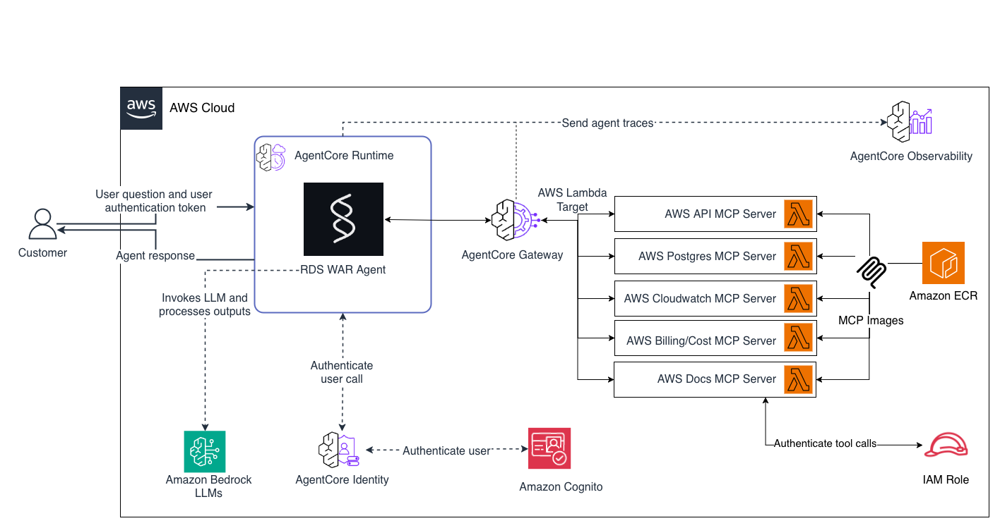

<!-- Copyright Amazon.com, Inc. or its affiliates. All Rights Reserved. -->
<!-- SPDX-License-Identifier: MIT-0 -->

# RDS/Aurora Agentic Well-Architected Review

## Overview

The RDS Agentic WAR is a multi-agent system that performs automated Well-Architected Reviews for Amazon RDS and Aurora databases. Built on the Model Context Protocol (MCP) and powered by Anthropic Claude models via Amazon Bedrock, this system uses specialized AI agents that collaborate to analyze five Well-Architected pillars (Performance, Security, Reliability, Cost Optimization, Operational Excellence) and generate a consolidated executive-ready Word document report. The AgentCore Gateway provides secure access to AWS data sources available as MCP tools.

### Use case details

| Information | Details |
|---|---|
| Use case type | Conversational |
| Agent type | Multi-agent (Coordinator + 5 pillar agents + Report Generator) |
| Use case components | Tools (MCP-based), CloudWatch, Cost Explorer, RDS/Aurora, Documentation |
| Use case vertical | Database Operations / Well-Architected Reviews |
| Example complexity | Advanced |
| SDK used | Amazon Bedrock AgentCore SDK, Strands Agents, MCP |

### Use case Architecture



### Use case key Features

- **Multi-Agent Orchestration**: A Coordinator agent routes queries to five pillar-specific agents based on keyword matching, then merges results into a final report
- **Well-Architected Framework Coverage**: Performance Efficiency, Security, Reliability, Cost Optimization, and Operational Excellence pillars
- **MCP-based Integration**: AgentCore Gateway provides secure access to five Lambda-hosted MCP servers with semantic search
- **Automated Report Generation**: Produces a Word document (.docx) with executive summary, per-pillar scores, implementation roadmap, and cost savings quantification
- **Container-based MCP Servers**: Each MCP server runs as a Docker container image on AWS Lambda, avoiding the 250MB zip size limit
- **Rollback-on-Failure Deployment**: Deployment scripts automatically clean up resources if any step fails (CloudFormation-style)
- **Flexible Scope**: Analyze a single pillar, multiple pillars, or run a full 5-pillar review

## Prerequisites

| Requirement | Description |
|---|---|
| Python 3.12+ | Python runtime |
| uv | Python package manager ([install guide](https://docs.astral.sh/uv/getting-started/installation/)) |
| Node.js 20.x+ | Required for CDK infrastructure |
| Docker | For building MCP server container images |
| AWS CLI | Configured with credentials (`aws configure`) |
| AgentCore CLI | `npm install -g @aws/agentcore-cli` |
| Amazon Bedrock access | Claude models enabled in your region |
| RDS/Aurora IAM auth or Data API | Target databases must have [IAM database authentication](https://docs.aws.amazon.com/AmazonRDS/latest/UserGuide/UsingWithRDS.IAMDBAuth.html) or [RDS Data API](https://docs.aws.amazon.com/AmazonRDS/latest/AuroraUserGuide/data-api.html) enabled for the agent to run database-level queries |

## Use case setup

```bash
# Clone the repository
git clone <repository-url>
cd rdsAgenticWAR

# Create and activate a virtual environment
cd app/agent
python -m venv .venv
source .venv/bin/activate  # On Windows: .venv\Scripts\activate

# Install dependencies
pip install -r requirements.txt

# Configure environment variables
cp .env.example .env  # Or create .env manually
# Edit .env and set:
#   AWS_REGION=us-east-1
#   AWS_PROFILE_LLM=your-aws-profile  (optional, uses default creds if empty)
#   BEDROCK_MODEL_ID=anthropic.claude-sonnet-4-20250514-v1:0

# Step 1: Deploy MCP server Lambda functions (builds Docker images, pushes to ECR)
python deploy_mcp_lambdas.py

# Step 2: Create the AgentCore Gateway (Cognito + Gateway + target registration)
python setup_gateway.py

# Step 3: Update .env with the Gateway URL from setup output
# GATEWAY_URL=https://your-gateway-id.gateway.bedrock-agentcore.us-east-1.amazonaws.com/mcp
```

> **Local Setup Complete**: Your RDS Agentic WAR agent is now ready to run locally. If you want to deploy to AgentCore Runtime for production use, follow the [Deployment](#deployment) section below.

## Execution instructions

### Single Query Mode

```bash
# Full 5-pillar Well-Architected review
python main.py --local "Full well-architected review of prod-aurora-cluster"

# Single pillar analysis
python main.py --local "Analyze cost optimization for my-rds-instance"

# Multiple pillars
python main.py --local "Check security and reliability of analytics-cluster"

# General question (no report generated)
python main.py --local "What Aurora PostgreSQL versions are approaching end of support?"

# Filter by tags or attributes
python main.py --local "Review performance of all databases tagged Environment=Production"
```

### Via AgentCore CLI (with hot-reload)

```bash
# From project root
agentcore dev

# Then invoke
agentcore invoke --prompt "Analyze performance of my-cluster"
```

## Development to Production Deployment Flow

The RDS Agentic WAR follows a structured deployment process from local development to production on Amazon Bedrock AgentCore Runtime.

```
STEP 1: LOCAL DEVELOPMENT
┌─────────────────────────────────────────────────────────────────────┐
│  Deploy MCP Lambdas: python deploy_mcp_lambdas.py                   │
│  └─> Setup Gateway: python setup_gateway.py                         │
│      └─> Test locally: python main.py --local "Analyze my-cluster"  │
│          └─> Agent connects to AgentCore Gateway via MCP protocol   │
└─────────────────────────────────────────────────────────────────────┘
                                    ↓
STEP 2: LOCAL DEVELOPMENT WITH AGENTCORE CLI
┌─────────────────────────────────────────────────────────────────────┐
│  Run with hot-reload: agentcore dev                                 │
│  └─> Invoke: agentcore invoke --prompt "Full review of my-cluster"  │
│      └─> Validates agent behavior before production deployment      │
└─────────────────────────────────────────────────────────────────────┘
                                    ↓
STEP 3: PRODUCTION DEPLOYMENT
┌─────────────────────────────────────────────────────────────────────┐
│  Deploy: agentcore deploy                                           │
│  └─> Packages agent code as CodeZip                                 │
│      └─> Deploys to AgentCore Runtime (managed, scalable)           │
│          └─> Test: agentcore invoke --prompt "..."                   │
│              └─> Production agent uses same Gateway + MCP servers    │
└─────────────────────────────────────────────────────────────────────┘

Key Points:
• Core agent code (app/agent/) remains unchanged across all stages
• MCP Lambda servers and Gateway are deployed once, shared by local and production
• Same agent works locally and in production via environment configuration
• AgentCore Gateway provides MCP tool access at all stages
```

## Deployment

Deploy to Amazon Bedrock AgentCore Runtime for production use:

```bash
# From project root
agentcore deploy

# Check status
agentcore status

# Invoke deployed agent
agentcore invoke --prompt "Full review of prod-cluster"

# View logs
agentcore logs
```

## Configuration

| Environment Variable | Description | Default |
|---|---|---|
| `AWS_REGION` | AWS region for all resources | `us-east-1` |
| `AWS_PROFILE_LLM` | AWS profile for Bedrock calls | (default credentials) |
| `BEDROCK_MODEL_ID` | Bedrock model for agents | `anthropic.claude-sonnet-4-20250514-v1:0` |
| `GATEWAY_URL` | AgentCore Gateway endpoint | (required — set after setup) |
| `REPORTS_DIR` | Output directory for reports | `~/reports` |

## AgentCore Observability

When deployed to AgentCore Runtime, the agent automatically integrates with Amazon CloudWatch for comprehensive monitoring through the observability primitive.

### Viewing Metrics and Traces

Once deployed with observability enabled, you can monitor your agent's performance through:

- **Amazon CloudWatch Metrics**: View request rates, latencies, and error rates
- **AWS X-Ray Traces**: Analyze distributed traces to understand request flow across the Coordinator and pillar agents
- **CloudWatch Logs**: Access structured logs for debugging and analysis

The observability primitive automatically captures:
- LLM invocation metrics (tokens, latency, model usage)
- Tool execution traces (duration, success/failure per MCP tool)
- End-to-end request tracing across all agent components
- Per-pillar agent execution time and cycle counts

### Built-in Usage Reporting

When running locally, the agent prints a detailed usage summary after each run including:
- Per-agent token breakdown (input/output)
- Tool call counts per agent
- Estimated cost based on model pricing
- Total execution time and cycle counts

For more details, see the [Amazon Bedrock AgentCore observability documentation](https://docs.aws.amazon.com/bedrock-agentcore/latest/devguide/observability-configure.html).

### Cross-Account Resource Review

To analyze RDS/Aurora resources in a different AWS account (Account B) from where the agent is deployed (Account A):

**1. In Account A — Update the Gateway IAM Role trust policy to allow assuming a role in Account B:**

```json
{
    "Version": "2012-10-17",
    "Statement": [
        {
            "Sid": "AllowCrossAccountAssume",
            "Effect": "Allow",
            "Action": "sts:AssumeRole",
            "Resource": "arn:aws:iam::<ACCOUNT_B_ID>:role/RdsAgenticWAR-CrossAccountRole"
        }
    ]
}
```

Attach this as an inline policy on the Lambda execution role (`McpLambdaExecRole-rdsAgenticWAR`).

**2. In Account B — Create a role that Account A can assume:**

Create a role named `RdsAgenticWAR-CrossAccountRole` with:

- **Trust policy** (allows Account A's Lambda role to assume it):
```json
{
    "Version": "2012-10-17",
    "Statement": [
        {
            "Effect": "Allow",
            "Principal": {
                "AWS": "arn:aws:iam::<ACCOUNT_A_ID>:role/McpLambdaExecRole-rdsAgenticWAR"
            },
            "Action": "sts:AssumeRole"
        }
    ]
}
```

- **Permissions** — Attach the same policies from the `policies/` folder:
  - `rds-access.json` — RDS/Aurora read access
  - `cost-access.json` — Cost Explorer access
  - `observability-access.json` — CloudWatch, Logs, EC2 security groups

**3. Invoke the agent with the cross-account context:**

When prompting the agent, specify the target account's cluster identifier or region. The MCP servers will use the assumed role credentials to access Account B's resources.

## Security

- MCP Lambda functions use **IAM auth** (Function URLs with `AWS_IAM` auth type)
- AgentCore Gateway uses **OAuth 2.0** (Amazon Cognito) for inbound authentication
- Gateway-to-Lambda communication uses **IAM Role** assumption
- All IAM policies follow **least-privilege** (read-only access only)
- ECR images have **scan-on-push** enabled
- No secrets stored in code — all credentials are runtime-resolved

## Clean up instructions

Remove all deployed AWS resources:

```bash
cd app/agent

# Step 1: Remove Gateway (deletes Cognito + Gateway + targets)
python setup_gateway.py --cleanup

# Step 2: Remove MCP Lambdas (deletes Lambda functions + ECR + IAM roles + policies)
python deploy_mcp_lambdas.py --cleanup
```

To also remove the AgentCore Runtime deployment:

```bash
# From project root
agentcore destroy
```

## Disclaimer

The examples provided in this repository are for educational purposes only. They demonstrate concepts and techniques. All recommendations, cost estimates, and optimization numbers generated by this agent are based on data collected at the time of analysis and reflect current cluster configuration and usage patterns. Before implementing any recommendation, review the proposed changes thoroughly and assess the potential impact on your application's performance and availability.
